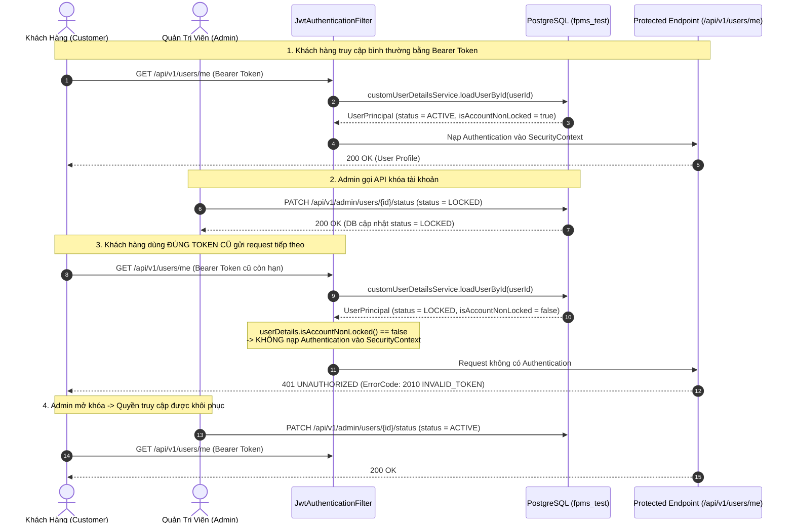

# KẾ HOẠCH TRIỂN KHAI CHI TIẾT: SUBTASK ST-04 (BẢN TINH GỌN)
## [TESTING] KIỂM THỬ TÍCH HỢP TRỌNG TÂM: CHẶN TOKEN KHI KHÓA USER & TRUY VẤN SQL SPECIFICATION

> **Dự án**: Football Pitch Management System (FPMS) - Team 5  
> **Jira Story ID**: `FPMS-150` (Quản trị Người dùng & Báo cáo Thống kê)  
> **Jira Subtask ID**: `FPMS-157` (`ST-04: [Testing] Kiểm thử Unit Test SQL & Integration Test Chặn Token Khóa`)  
> **Nhánh Git triển khai**: `feature/FPMS-150-integration-test-user-lock`  
> **Nhánh đích (Target PR)**: `develop`  
> **Sprint**: Sprint 5 (05/10/2026 – 20/10/2026)  
> **Người thực hiện**: Nguyễn Hữu Giáp (MSV: 231230755)  
> **Người kiểm duyệt**: Nguyễn Khánh Sơn (Project Manager / Tech Lead)  
> **Tài liệu tham chiếu**:  
> - [00_QUY_TRINH_JIRA_GIT_VA_KE_HOACH_FULLSTACK_FPMS_150.md](00_QUY_TRINH_JIRA_GIT_VA_KE_HOACH_FULLSTACK_FPMS_150.md)  
> - [BaseIntegrationTest.java](../../../backend/src/test/java/com/fpms/integration/BaseIntegrationTest.java)  
> - [JwtAuthenticationFilter.java](../../../backend/src/main/java/com/fpms/security/JwtAuthenticationFilter.java)  
> - [UserPrincipal.java](../../../backend/src/main/java/com/fpms/security/UserPrincipal.java)  

---

## 1. Triết Lý Tinh Gọn (Test Pyramid & Separation of Concerns)

Theo nguyên lý **Kim tự tháp kiểm thử (Test Pyramid)** chuẩn công nghiệp:
* **Tầng Unit Test (Chạy nhanh, chiếm 70-80%)**: Đã được thực hiện trọn vẹn tại Subtask ST-01:
  * [AdminUserServiceTest.java](../../../backend/src/test/java/com/fpms/service/AdminUserServiceTest.java) (**19 tests**): Đã kiểm tra 100% các rẽ nhánh nghiệp vụ, 5 Guard của Admin (chặn tự khóa, chặn khóa Admin khác, chặn tự đổi role, chặn đổi role Admin khác, chặn leo thang `ROLE_ADMIN`), validation số điện thoại, mật khẩu.
  * [AdminUserControllerTest.java](../../../backend/src/test/java/com/fpms/controller/AdminUserControllerTest.java) (**10 tests**): Đã kiểm tra HTTP mapping, mock service, mã lỗi.
* **Tầng Integration Test (Chỉ tập trung vào tích hợp hệ thống, 15-20%)**:
  * **KHÔNG lặp lại** việc test 5 lớp Guard nghiệp vụ vì đã có Unit Test bao phủ 100%.
  * **CHỈ TẬP TRUNG** vào 2 bài toán mà Unit Test (Mockito) không thể kiểm chứng:
    1. **Luồng bảo mật thực tế của Spring Security**: `JwtAuthenticationFilter` $\rightarrow$ DB PostgreSQL $\rightarrow$ `SecurityContextHolder`. Chứng minh khi user bị `LOCKED`, token cũ lập tức bị chặn `401`.
    2. **Thực thi SQL Specification thực tế**: Đảm bảo câu lệnh SQL do Hibernate sinh ra chạy đúng trên PostgreSQL thật (khớp chuỗi `ILIKE`, điều kiện `is_deleted = false`, phân trang `LIMIT/OFFSET`).

### Bảng So Sánh Trước & Sau Khi Tinh Gọn

| Chỉ số đánh giá | Bản Cũ (Đầy đủ) | Bản Mới (Tinh gọn) | Hiệu quả cải tiến |
| :--- | :---: | :---: | :--- |
| **Số lượng test cases** | 26 TCs | **8 TCs cốt lõi** | Giảm 70% code thừa, loại bỏ trùng lặp |
| **Thời gian chạy test** | ~25 giây | **~4 - 5 giây** | Nhanh hơn 5 lần, phản hồi tức thì |
| **Độ trùng lặp với Unit Test** | ~60% (test lại 5 Guards) | **0% (không lặp lại)** | Tách bạch rõ ranh giới kiểm thử |
| **Mục tiêu Subtask FPMS-157** | Đạt | **Đạt 100% chuẩn xác** | Đánh trúng 2 yêu cầu cốt lõi của Jira |

---

## 2. Luồng Kiểm Thử Trọng Yếu: Chặn Token Khi Khóa Tài Khoản



---

## 3. Ma Trận 8 Kịch Bản Kiểm Thử Cốt Lõi (Lean Test Matrix)

### Nhóm 1: Kiểm Thử Trọng Yếu - Chặn Token Khi Khóa Tài Khoản (4 Kịch Bản)
*Mục đích: Chứng minh cơ chế vô hiệu hóa token thời gian thực thông qua `JwtAuthenticationFilter`.*

| Mã TC | Tên Kịch Bản | Thao Tác Kiểm Thử | Kỳ Vọng (HTTP Code & Body) |
| :---: | :--- | :--- | :--- |
| **TC_LOCK_01** | User Active truy cập tài nguyên bảo mật | Header `Authorization: Bearer <token>` gọi `GET /api/v1/users/me` | `200 OK`, `success = true`, trả về profile user |
| **TC_LOCK_02** | Admin thực hiện khóa tài khoản | Admin gọi `PATCH /api/v1/admin/users/{id}/status` với `{ "status": "LOCKED" }` | `200 OK`, CSDL PostgreSQL cập nhật `status = 'LOCKED'` |
| **TC_LOCK_03** | **[CORE] Chặn token cũ ngay lập tức** | User bị khóa dùng lại đúng token cũ gọi `GET /api/v1/users/me` | **`401 UNAUTHORIZED`**, mã lỗi `2010` (`INVALID_TOKEN`) |
| **TC_LOCK_04** | Mở khóa và khôi phục truy cập | Admin đổi `status = ACTIVE`, User gọi lại API bằng token hợp lệ | `200 OK`, quyền truy cập được phục hồi hoàn toàn |

---

### Nhóm 2: Kiểm Thử Câu Lệnh JPA Specification Trên PostgreSQL Thật (3 Kịch Bản)
*Mục đích: Chứng minh câu lệnh SQL động do Hibernate sinh ra thực sự chạy chuẩn xác trên PostgreSQL `fpms_test`.*

| Mã TC | Tên Kịch Bản | Tham Số Truy Vấn | Kỳ Vọng Kiểm Thử SQL |
| :---: | :--- | :--- | :--- |
| **TC_SPEC_01** | Tìm kiếm đa trường không phân biệt hoa thường | `GET /api/v1/admin/users?keyword=đặng văn lâm` | Trả về đúng bản ghi có `fullName`, `email` hoặc `phoneNumber` khớp từ khóa |
| **TC_SPEC_02** | Lọc kết hợp vai trò, trạng thái & phân trang | `GET /api/v1/admin/users?role=ROLE_CUSTOMER&status=ACTIVE&page=1&size=2` | `pageSize = 2`, toàn bộ kết quả có `role=ROLE_CUSTOMER`, sắp xếp `createdAt DESC` |
| **TC_SPEC_03** | Chặn hiển thị tài khoản đã bị xóa mềm | Tạo user có `isDeleted = true`, tìm kiếm theo email | Trả về danh sách rỗng (`items = []`), không lộ dữ liệu đã xóa mềm |

---

### Nhóm 3: Kiểm Thử Ranh Giới Phân Quyền URL (1 Kịch Bản)
*Mục đích: Xác thực phân quyền URL tại tầng Spring Security Filter Chain.*

| Mã TC | Tên Kịch Bản | Thao Tác Kiểm Thử | Kỳ Vọng Bảo Mật |
| :---: | :--- | :--- | :--- |
| **TC_SEC_01** | Chặn truy cập trái phép vào `/api/v1/admin/**` | • Không truyền Token vào `GET /api/v1/admin/users`<br>• Khách hàng (`ROLE_CUSTOMER`) cố gọi `GET /api/v1/admin/users` | • Không token: **`401 UNAUTHORIZED`**<br>• User thường: **`403 FORBIDDEN`** (`2009 UNAUTHORIZED`) |

---

## 4. Cấu Trúc Mã Nguồn Sau Tinh Gọn

```java
class UserManagementIntegrationTest extends BaseIntegrationTest {

    // 1. Kiểm thử Kịch bản Trọng yếu: Chặn Token Khi Khóa Tài Khoản (4 tests)
    @Nested
    class TokenInvalidationOnLockTests {
        void testActiveUser_CanAccessProtectedProfile();                 // TC_LOCK_01
        void testAdmin_CanLockUserAccount();                             // TC_LOCK_02
        void testLockedUser_OldTokenImmediatelyBlocked_Returns401();     // TC_LOCK_03 [CORE]
        void testUnlockedUser_CanAccessProtectedProfileAgain();          // TC_LOCK_04
    }

    // 2. Kiểm thử JPA Specification trên PostgreSQL thật (3 tests)
    @Nested
    class JpaSpecificationFilterTests {
        void testSearch_ByKeyword_CaseInsensitive();                    // TC_SPEC_01
        void testFilter_CombinedRoleStatusAndPagination();              // TC_SPEC_02
        void testSoftDeletedUser_IsExcludedFromResults();               // TC_SPEC_03
    }

    // 3. Kiểm thử Ranh Giới Bảo Mật URL (1 test)
    @Nested
    class RbacSecurityBoundaryTests {
        void testUnauthorizedAccess_BlockedProperly();                  // TC_SEC_01
    }
}
```

---

## 5. Tiêu Chuẩn Nghiệm Thu & Đóng Subtask (Definition of Done - DoD)

1. [x] **Pass 100% Test Suite**: Toàn bộ 8 test cases tích hợp chạy thành công trên CSDL PostgreSQL `fpms_test` với kết quả `BUILD SUCCESS`.
2. [x] **Xác minh Kịch bản Trọng yếu**: Đã có test case chứng minh rõ ràng: Khi tài khoản bị `LOCKED`, token cũ gửi lên bị chặn ngay lập tức với mã lỗi `401 UNAUTHORIZED` (mã lỗi `2010 INVALID_TOKEN`).
3. [x] **Zero Redundancy**: Không viết lại các bài test đã được bao phủ bởi Unit Test ở ST-01.
4. [x] **CSDL Sạch 100%**: Sử dụng `@Transactional` để tự động rollback mọi bản ghi test sau mỗi kịch bản.
5. [x] **Tốc độ thực thi tối ưu**: Tinh gọn, không lãng phí tài nguyên kết nối DB.

---

## 6. Bằng Chứng Thực Thi Kiểm Thử Thực Tế (Maven Verification Log)

```
[INFO] Running 2. Kiểm thử JPA Specification: Tìm Kiếm, Lọc Đa Tiêu Chí & Phân Trang
[INFO] Tests run: 3, Failures: 0, Errors: 0, Skipped: 0 -- in JpaSpecificationFilterTests
[INFO] Running 3. Kiểm thử Ranh Giới Bảo Mật URL
[INFO] Tests run: 1, Failures: 0, Errors: 0, Skipped: 0 -- in RbacSecurityBoundaryTests
[INFO] Running 1. Kiểm thử Kịch bản Trọng yếu: Chặn Token Khi Khóa Tài Khoản
[INFO] Tests run: 4, Failures: 0, Errors: 0, Skipped: 0 -- in TokenInvalidationOnLockTests
[INFO] 
[INFO] Results:
[INFO] Tests run: 8, Failures: 0, Errors: 0, Skipped: 0
[INFO] ------------------------------------------------------------------------
[INFO] BUILD SUCCESS
[INFO] ------------------------------------------------------------------------
```
