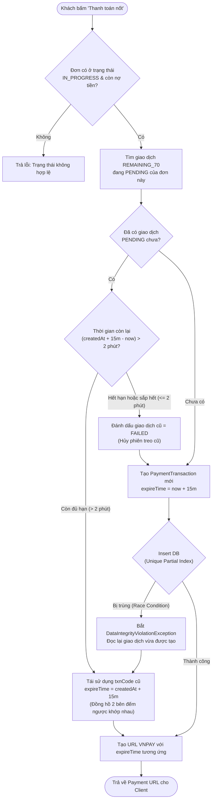

# Kế Hoạch Triển Khai Xử Lý Concurrency & Quản Lý Hạn Giao Dịch (Thanh Toán Nốt 70%)

## 1. Đặt Vấn Đề (Problem Statement)

Khi người dùng thực hiện thanh toán nốt tiền sân (loại `REMAINING_70`) qua VNPAY:
1. **Bài toán trùng lặp (Double Payment / Race Condition):** Nếu hai người (hoặc cùng một người ở 2 thiết bị/trình duyệt) cùng bấm nút **"Thanh toán nốt"** tại cùng một thời điểm:
   - Hệ thống có nguy cơ tạo ra 2 bản ghi giao dịch `PENDING` khác nhau với 2 mã `txnCode` riêng biệt.
   - Nếu cả 2 người cùng quét mã và trừ tiền trên ứng dụng ngân hàng, khách hàng sẽ bị **trừ tiền 2 lần** cho cùng một đơn đặt sân.
2. **Bài toán thời gian hết hạn (Expiration Time Management):**
   - VNPAY yêu cầu tham số `vnp_ExpireDate` khi tạo URL thanh toán (mặc định cấu hình 15 phút).
   - Nếu tái sử dụng lại giao dịch `PENDING` có sẵn, cần giải quyết câu hỏi: **Thời gian 15 phút sẽ tính lại từ đầu hay tính theo thời gian còn lại của giao dịch trước đó?**
   - Nếu giao dịch cũ đã bị bỏ dở lâu (ví dụ còn 1 phút hoặc đã quá 15 phút), việc trả về link cũ sẽ khiến người dùng bị lỗi hết hạn ngay khi vừa mở VNPAY.

---

## 2. Kiến Trúc Giải Pháp (Solution Design)

Áp dụng chiến lược **Phòng thủ 2 lớp (Two-Layer Defense)** kết hợp **Tái sử dụng phiên thông minh (Smart Session Reuse)**:



### Nguyên tắc tính thời gian hết hạn:
1. **Còn đủ thời gian (> 2 phút):** Giữ nguyên mốc kết thúc gốc `expireAt = createdAt + 15 phút`. Cả hai trình duyệt đều đếm ngược về đúng một thời điểm.
2. **Hết hạn hoặc sắp hết hạn (<= 2 phút):** Hủy giao dịch cũ (`status = FAILED`), tạo giao dịch mới toanh với 15 phút trọn vẹn từ thời điểm hiện tại.

---

## 3. Các Bước Triển Khai Chi Tiết (Implementation Steps)

### Bước 1: Tạo Unique Partial Index trong PostgreSQL (Database Layer)
Chỉ cho phép duy nhất **một** bản ghi `REMAINING_70` ở trạng thái `PENDING` cho mỗi `booking_id`. Các bản ghi `SUCCESS` hoặc `FAILED` vẫn được lưu nhiều lần bình thường để phục vụ lịch sử đối soát.

**Câu lệnh SQL:**
```sql
CREATE UNIQUE INDEX idx_unique_pending_remaining_booking 
ON payment_transactions (booking_id) 
WHERE payment_type = 'REMAINING_70' AND status = 'PENDING';
```
*(Lưu ý: Chạy trực tiếp trên PostgreSQL database `fpms`)*.

---

### Bước 2: Cập nhật `PaymentTransactionRepository`
Thêm hàm tìm giao dịch `PENDING` loại thanh toán nốt của booking:

```java
// backend/src/main/java/com/fpms/repository/PaymentTransactionRepository.java

@Query("SELECT t FROM PaymentTransaction t " +
       "WHERE t.booking.id = :bookingId " +
       "AND t.paymentType = com.fpms.entity.enums.PaymentType.REMAINING_70 " +
       "AND t.status = com.fpms.entity.enums.TransactionStatus.PENDING")
Optional<PaymentTransaction> findPendingRemainingTransaction(@Param("bookingId") Long bookingId);
```

---

### Bước 3: Cập nhật logic `payRemainingBooking` trong `BookingServiceImpl`
Thay thế logic tạo mới mù quáng bằng luồng kiểm tra thông minh:

```java
// backend/src/main/java/com/fpms/service/impl/BookingServiceImpl.java

@Override
@Transactional
public BookingDepositResponse payRemainingBooking(Long bookingId, UserPrincipal userPrincipal, HttpServletRequest httpRequest) {
    // 1. Kiểm tra quyền và trạng thái đơn booking (như hiện tại)
    ...
    
    // 2. Tìm giao dịch PENDING đang tồn tại (nếu có)
    Optional<PaymentTransaction> pendingTxnOpt = paymentTransactionRepository.findPendingRemainingTransaction(booking.getId());
    
    PaymentTransaction transaction;
    LocalDateTime now = LocalDateTime.now(ZoneId.of("Asia/Ho_Chi_Minh"));
    LocalDateTime expireTime;

    if (pendingTxnOpt.isPresent()) {
        PaymentTransaction existingTxn = pendingTxnOpt.get();
        LocalDateTime originalExpireTime = existingTxn.getCreatedAt().plusMinutes(15);

        // Nếu phiên cũ còn hơn 2 phút hiệu lực -> Tái sử dụng
        if (now.isBefore(originalExpireTime.minusMinutes(2))) {
            transaction = existingTxn;
            expireTime = originalExpireTime; // Giữ nguyên mốc hết hạn gốc
        } else {
            // Phiên cũ đã hết hạn hoặc cận kề hết hạn -> Hủy phiên cũ
            existingTxn.setStatus(TransactionStatus.FAILED);
            existingTxn.setNote(existingTxn.getNote() + " [Hủy do hết hạn thanh toán]");
            paymentTransactionRepository.save(existingTxn);

            // Tạo phiên mới 15 phút
            transaction = createNewRemainingTransaction(booking, vnpayMethod, remainingAmount);
            expireTime = now.plusMinutes(15);
        }
    } else {
        // Chưa có phiên nào -> Tạo mới
        try {
            transaction = createNewRemainingTransaction(booking, vnpayMethod, remainingAmount);
            expireTime = now.plusMinutes(15);
        } catch (DataIntegrityViolationException ex) {
            // Race condition: Trình duyệt khác vừa tạo xong trong mili-giây vừa qua
            transaction = paymentTransactionRepository.findPendingRemainingTransaction(booking.getId())
                    .orElseThrow(() -> ex);
            expireTime = transaction.getCreatedAt().plusMinutes(15);
        }
    }

    // 3. Tạo URL VNPAY với expireTime đã tính toán
    String paymentUrl = buildVNPayUrl(
            booking,
            transaction.getTransactionCode(),
            remainingAmount,
            "Thanh toan not 70% don " + booking.getBookingCode(),
            expireTime,
            httpRequest
    );

    return BookingDepositResponse.builder()
            .bookingCode(booking.getBookingCode())
            .bookingId(booking.getId())
            .depositAmount(booking.getDepositAmount())
            .remainingAmount(remainingAmount)
            .paymentUrl(paymentUrl)
            .build();
}
```

---

### Bước 4: Xử lý Idempotency tại Callback / IPN (`PaymentServiceImpl`)
Khi nhận kết quả thanh toán từ VNPAY trả về:
1. Tra cứu transaction theo `vnp_TxnRef`.
2. Kiểm tra trạng thái:
   - Nếu transaction đã ở trạng thái `SUCCESS`: Bỏ qua (không xử lý lại).
   - Nếu booking đã ở trạng thái `COMPLETED`: Không cộng trừ thêm tiền hay đổi trạng thái thừa.
3. Khi cập nhật `SUCCESS`:
   - Set `status = TransactionStatus.SUCCESS`.
   - Cập nhật đơn đặt sân: `remainingAmount = 0`, chuyển trạng thái đơn (hoặc hoàn tất thanh toán).

---

### Bước 5: Tối ưu UI/UX Frontend
1. **Khóa nút khi bấm:** Ngay khi khách hàng bấm *"Thanh toán nốt"*, disable nút và hiển thị spinner để tránh người dùng click liên tục nhiều lần trên cùng 1 máy.
2. **Xử lý khi đơn đã hoàn tất:** Nếu một bên đã thanh toán thành công, trang chi tiết ca đá / chi tiết đơn khi reload hoặc nhận websocket cần hiển thị ngay badge **"Đã thanh toán đủ"**, ẩn nút thanh toán nốt.

---

## 4. Kịch Bản Kiểm Thử (Test Cases)

| STT | Kịch bản | Hành vi kỳ vọng |
|:---|:---|:---|
| 1 | **2 người cùng bấm cách nhau 5 giây** | Cả 2 nhận cùng `txnCode`. Màn hình VNPAY của cả 2 đếm ngược về cùng một thời điểm (15 phút tính từ người 1). |
| 2 | **2 người bấm chính xác cùng 1 mili-giây** | 1 request tạo thành công, 1 request gặp unique constraint DB $\rightarrow$ Bắt ngoại lệ và trả về cùng transaction đó. Không lỗi 500. |
| 3 | **Người 1 thanh toán thành công, người 2 mới quét mã** | VNPAY từ chối thanh toán cho giao dịch đã hoàn tất. Không bị trừ tiền lần 2. |
| 4 | **Người 1 bấm rồi bỏ đi, 20 phút sau người 2 bấm** | Hệ thống nhận diện giao dịch cũ đã quá 15 phút $\rightarrow$ Đánh dấu `FAILED` và sinh giao dịch mới với 15 phút trọn vẹn. |
| 5 | **Người 1 bấm lúc 14 phút trước (chỉ còn 1 phút)** | Hệ thống nhận diện thời gian còn lại $\le$ 2 phút $\rightarrow$ Hủy giao dịch cũ, sinh giao dịch mới đủ 15 phút để khách kịp thao tác. |

