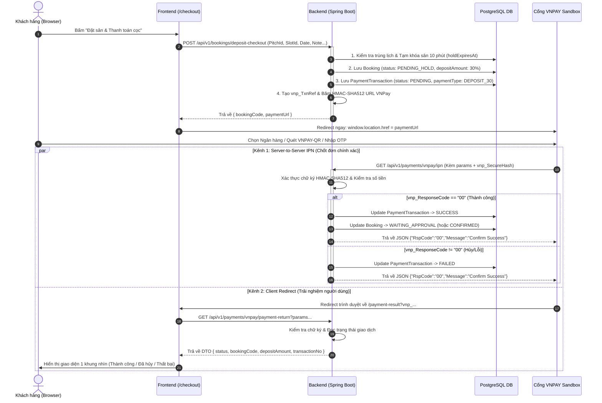

# ⚽ Tài liệu Triển khai Tích hợp Cổng thanh toán VNPAY - Soccer365 (FPMS)
## Luồng Đặt sân & Tự động Chuyển hướng Thanh toán Tiền cọc (Deposit 30%)

> **Tài liệu tham chiếu:** Dựa trên chuẩn bảo mật & kinh nghiệm thực chiến từ [VNPAY_INTEGRATION_GUIDE.md](file:///c:/Users/Admin/Desktop/Football/football-pitch-management-system/docs/workflow/VNPAY_INTEGRATION_GUIDE.md)  
> **Áp dụng cho:** Hệ thống Quản lý Sân bóng Soccer365 (Backend: Spring Boot 3 + PostgreSQL/Redis | Frontend: React + TypeScript + TailwindCSS)

---

## 📑 Mục lục
1. [Nghiệp vụ Đặt cọc & Kiến trúc luồng VNPAY](#1-nghiệp-vụ-đặt-cọc--kiến-trúc-luồng-vnpay)
2. [Cấu hình môi trường (Sandbox & application.properties)](#2-cấu-hình-môi-trường-sandbox--applicationproperties)
3. [Thiết kế Dữ liệu & Entities liên quan](#3-thiết-kế-dữ-liệu--entities-liên-quan)
4. [Chi tiết Triển khai Backend (Spring Boot)](#4-chi-tiết-triển-khai-backend-spring-boot)
   - [4.1. Lớp cấu hình & Tiện ích băm chữ ký (VNPayConfig & VNPayUtil)](#41-lớp-cấu-hình--tiện-ích-băm-chữ-ký-vnpayconfig--vnpayutil)
   - [4.2. API Khởi tạo Đặt sân & Tạo URL Thanh toán cọc](#42-api-khởi-tạo-đặt-sân--tạo-url-thanh-toán-cọc)
   - [4.3. API Xử lý Return URL (Hiển thị kết quả cho khách hàng)](#43-api-xử-lý-return-url-hiển-thị-kết-quả-cho-khách-hàng)
   - [4.4. API Xử lý IPN Webhook (Server-to-Server chốt cọc chuẩn xác)](#44-api-xử-lý-ipn-webhook-server-to-server-chốt-cọc-chuẩn-xác)
5. [Chi tiết Triển khai Frontend (React + Vite + TypeScript)](#5-chi-tiết-triển-khai-frontend-react--vite--typescript)
   - [5.1. Xử lý Chuyển hướng tức thì tại CheckoutForm](#51-xử-lý-chuyển-hướng-tức-thì-tại-checkoutform)
   - [5.2. Trang Kết quả Thanh toán (PaymentResult.tsx) chuẩn Viewport](#52-trang-kết-quả-thanh-toán-paymentresulttsx-chuẩn-viewport)
   - [5.3. Định tuyến Routes & Điều hướng](#53-định-tuyến-routes--điều-hướng)
6. [Ma trận Kiểm thử & Kịch bản Test Sandbox](#6-ma-trận-kiểm-thử--kịch-bản-test-sandbox)
7. [Checklist An toàn & Xử lý sự cố thực tế](#7-checklist-an-toàn--xử-lý-sự-cố-thực-tế)

---

## 1. Nghiệp vụ Đặt cọc & Kiến trúc luồng VNPAY

### 1.1. Bối cảnh nghiệp vụ sân bóng
- Khi người dùng đặt sân Online, giá sân được tính tự động từ bảng giá `price_matrices` (phụ thuộc vào loại sân 5/7/11, khung giờ cao điểm / bình thường, và loại ngày thường / cuối tuần / lễ).
- Người dùng **bắt buộc thanh toán cọc 30%** (`depositAmount = totalPitchAmount * 0.3`) để giữ sân.
- Khi người dùng bấm nút **"Đặt sân & Thanh toán cọc"**:
  1. Hệ thống tạo đơn `Booking` với trạng thái `PENDING_HOLD` (tạm khóa khung giờ trong **10 phút**).
  2. Tạo bản ghi giao dịch `PaymentTransaction` trạng thái `PENDING`, loại `DEPOSIT_30`.
  3. Backend tạo URL thanh toán VNPay có gắn mã tham chiếu duy nhất `vnp_TxnRef`.
  4. Trình duyệt Frontend nhận URL và **nhảy ngay lập tức** sang cổng VNPay (`window.location.href = paymentUrl`).
  5. 70% còn lại (`remainingAmount`) sẽ thanh toán trực tiếp tại quầy khi kết thúc trận đấu.

### 1.2. Sơ đồ tuần tự (Sequence Diagram)



---

## 2. Cấu hình môi trường (Sandbox & application.properties)

### 2.1. Thông tin Sandbox VNPAY
- **URL Cổng thanh toán:** `https://sandbox.vnpayment.vn/paymentv2/vpcpay.html`
- **Tài khoản test VNPAY:**
  - Ngân hàng: `NCB`
  - Số thẻ: `9704198526191432198`
  - Tên chủ thẻ: `NGUYEN VAN A`
  - Ngày phát hành: `07/15`
  - Mật khẩu OTP: `123456`

### 2.2. Khai báo trong `backend/src/main/resources/application.properties`

```properties
# ==========================================
# Cấu hình Cổng thanh toán VNPAY (Sandbox)
# ==========================================
vnpay.tmn-code=${VNPAY_TMN_CODE:YOUR_TMN_CODE}
vnpay.hash-secret=${VNPAY_HASH_SECRET:YOUR_HASH_SECRET}
vnpay.pay-url=https://sandbox.vnpayment.vn/paymentv2/vpcpay.html
vnpay.return-url=${VNPAY_RETURN_URL:http://localhost:5173/payment-result}
vnpay.version=2.1.0
vnpay.command=pay
```

---

## 3. Thiết kế Dữ liệu & Entities liên quan

Hệ thống đã có sẵn các Entity chuẩn trong gói `com.fpms.entity`:

### 3.1. Entity `Booking`
- `status`:
  - Ban đầu khi ấn đặt cọc: `BookingStatus.PENDING_HOLD` (khóa tạm 10 phút, `holdExpiresAt = LocalDateTime.now().plusMinutes(10)`).
  - Khi cọc thành công: Chuyển sang `BookingStatus.WAITING_APPROVAL` (Chờ chủ sân duyệt) hoặc `BookingStatus.CONFIRMED`.
  - Nếu khách hủy thanh toán hoặc quá 10 phút không thanh toán: Job Scheduler quét hủy chuyển thành `BookingStatus.CANCELLED`.
- `depositAmount`: Số tiền cọc 30%.
- `remainingAmount`: Số tiền 70% còn lại.

### 3.2. Entity `PaymentTransaction`
- `transactionCode`: Mã định danh nội bộ hệ thống, format: `TXN_{timestamp}_{random}` hoặc `TXN_{bookingCode}_DEP`.
- `referenceCode`: Mã giao dịch trả về từ VNPay (`vnp_TransactionNo`).
- `paymentType`: `PaymentType.DEPOSIT_30`.
- `status`: Sử dụng `TransactionStatus` (`PENDING`, `SUCCESS`, `FAILED`).
- `amount`: Số tiền thanh toán cọc thực tế (VND).
- `booking`: Khóa ngoại trỏ đến đơn `Booking`.
- `paymentMethod`: Khóa ngoại trỏ đến `PaymentMethod` có mã `VNPAY`.

---

## 4. Chi tiết Triển khai Backend (Spring Boot)

### 4.1. Lớp cấu hình & Tiện ích băm chữ ký (VNPayConfig & VNPayUtil)

Tạo file `com.fpms.config.VNPayConfig`:
```java
package com.fpms.config;

import lombok.Getter;
import org.springframework.beans.factory.annotation.Value;
import org.springframework.context.annotation.Configuration;

@Configuration
@Getter
public class VNPayConfig {
    @Value("${vnpay.tmn-code}")
    private String tmnCode;

    @Value("${vnpay.hash-secret}")
    private String hashSecret;

    @Value("${vnpay.pay-url}")
    private String payUrl;

    @Value("${vnpay.return-url}")
    private String returnUrl;

    @Value("${vnpay.version}")
    private String version;

    @Value("${vnpay.command}")
    private String command;
}
```

Tạo file `com.fpms.util.VNPayUtil`:
```java
package com.fpms.util;

import jakarta.servlet.http.HttpServletRequest;
import javax.crypto.Mac;
import javax.crypto.spec.SecretKeySpec;
import java.net.URLEncoder;
import java.nio.charset.StandardCharsets;
import java.util.*;

public class VNPayUtil {

    public static String hmacSHA512(final String key, final String data) {
        try {
            if (key == null || data == null) {
                throw new NullPointerException();
            }
            final Mac hmac512 = Mac.getInstance("HmacSHA512");
            byte[] hmacKeyBytes = key.getBytes(StandardCharsets.UTF_8);
            final SecretKeySpec secretKey = new SecretKeySpec(hmacKeyBytes, "HmacSHA512");
            hmac512.init(secretKey);
            byte[] dataBytes = data.getBytes(StandardCharsets.UTF_8);
            byte[] result = hmac512.doFinal(dataBytes);
            StringBuilder sb = new StringBuilder(2 * result.length);
            for (byte b : result) {
                sb.append(String.format("%02x", b & 0xff));
            }
            return sb.toString();
        } catch (Exception ex) {
            return "";
        }
    }

    public static String getIpAddress(HttpServletRequest request) {
        String ipAddress = request.getHeader("X-FORWARDED-FOR");
        if (ipAddress == null || ipAddress.isEmpty() || "unknown".equalsIgnoreCase(ipAddress)) {
            ipAddress = request.getRemoteAddr();
        }
        if (ipAddress != null && ipAddress.contains(",")) {
            ipAddress = ipAddress.split(",")[0].trim();
        }
        return (ipAddress == null || ipAddress.equals("0:0:0:0:0:0:0:1")) ? "127.0.0.1" : ipAddress;
    }

    public static String buildHashData(Map<String, String> params) {
        List<String> fieldNames = new ArrayList<>(params.keySet());
        Collections.sort(fieldNames);
        StringBuilder hashData = new StringBuilder();
        for (String fieldName : fieldNames) {
            String fieldValue = params.get(fieldName);
            if (fieldValue != null && !fieldValue.isEmpty()) {
                hashData.append(fieldName).append('=')
                        .append(URLEncoder.encode(fieldValue, StandardCharsets.US_ASCII))
                        .append('&');
            }
        }
        if (hashData.length() > 0) {
            hashData.setLength(hashData.length() - 1);
        }
        return hashData.toString();
    }
}
```

---

### 4.2. API Khởi tạo Đặt sân & Tạo URL Thanh toán cọc

Tạo DTO response trả về cho Frontend:
```java
package com.fpms.dto.response;

import lombok.Builder;
import lombok.Data;
import java.math.BigDecimal;

@Data
@Builder
public class BookingDepositResponse {
    private String bookingCode;
    private Long bookingId;
    private BigDecimal depositAmount;
    private String paymentUrl; // Frontend dùng url này để redirect ngay lập tức
}
```

Trong `BookingService` bổ sung method `createBookingWithDepositPayment`:
```java
@Transactional
public BookingDepositResponse createBookingWithDepositPayment(
        BookingCreationRequest request, 
        UserPrincipal userPrincipal, 
        HttpServletRequest httpRequest
) {
    // 1. Tạo đơn Booking (đã có logic tính 30% cọc và tạm khóa 10 phút)
    BookingResponse bookingResponse = createBooking(request, userPrincipal);
    Booking booking = bookingRepository.findByBookingCode(bookingResponse.getBookingCode())
            .orElseThrow(() -> new AppException(ErrorCode.BOOKING_NOT_FOUND));

    // 2. Tìm PaymentMethod VNPAY
    PaymentMethod vnpayMethod = paymentMethodRepository.findByCode(PaymentMethodCode.VNPAY)
            .orElseThrow(() -> new RuntimeException("Phương thức VNPay chưa được kích hoạt"));

    // 3. Tạo PaymentTransaction (PENDING)
    String txnCode = "TXN_" + System.currentTimeMillis() + "_" + booking.getId();
    PaymentTransaction transaction = PaymentTransaction.builder()
            .transactionCode(txnCode)
            .booking(booking)
            .paymentMethod(vnpayMethod)
            .amount(booking.getDepositAmount())
            .paymentType(PaymentType.DEPOSIT_30)
            .status(TransactionStatus.PENDING)
            .note("Thanh toan tien coc 30% don " + booking.getBookingCode())
            .build();
    paymentTransactionRepository.save(transaction);

    // 4. Sinh URL thanh toán VNPay
    String vnpTxnRef = txnCode; // Mã giao dịch gửi sang VNPay
    long amountInVnpayFormat = booking.getDepositAmount().multiply(BigDecimal.valueOf(100)).longValue();

    Map<String, String> vnpParams = new HashMap<>();
    vnpParams.put("vnp_Version", vnPayConfig.getVersion());
    vnpParams.put("vnp_Command", vnPayConfig.getCommand());
    vnpParams.put("vnp_TmnCode", vnPayConfig.getTmnCode());
    vnpParams.put("vnp_Amount", String.valueOf(amountInVnpayFormat)); // NHÂN 100
    vnpParams.put("vnp_CurrCode", "VND");
    vnpParams.put("vnp_TxnRef", vnpTxnRef);
    vnpParams.put("vnp_OrderInfo", "Dat coc san bong don " + booking.getBookingCode());
    vnpParams.put("vnp_OrderType", "other");
    vnpParams.put("vnp_Locale", "vn");
    vnpParams.put("vnp_ReturnUrl", vnPayConfig.getReturnUrl());
    vnpParams.put("vnp_IpAddr", VNPayUtil.getIpAddress(httpRequest));
    
    SimpleDateFormat formatter = new SimpleDateFormat("yyyyMMddHHmmss");
    Calendar cld = Calendar.getInstance(TimeZone.getTimeZone("Etc/GMT+7"));
    vnpParams.put("vnp_CreateDate", formatter.format(cld.getTime()));
    
    // Hạn thanh toán 10 phút
    cld.add(Calendar.MINUTE, 10);
    vnpParams.put("vnp_ExpireDate", formatter.format(cld.getTime()));

    // Sắp xếp key & build query string
    List<String> fieldNames = new ArrayList<>(vnpParams.keySet());
    Collections.sort(fieldNames);
    StringBuilder hashData = new StringBuilder();
    StringBuilder query = new StringBuilder();
    for (String fieldName : fieldNames) {
        String fieldValue = vnpParams.get(fieldName);
        if (fieldValue != null && !fieldValue.isEmpty()) {
            hashData.append(fieldName).append('=').append(URLEncoder.encode(fieldValue, StandardCharsets.US_ASCII)).append('&');
            query.append(URLEncoder.encode(fieldName, StandardCharsets.US_ASCII)).append('=')
                 .append(URLEncoder.encode(fieldValue, StandardCharsets.US_ASCII)).append('&');
        }
    }
    hashData.setLength(hashData.length() - 1);
    query.setLength(query.length() - 1);

    String secureHash = VNPayUtil.hmacSHA512(vnPayConfig.getHashSecret(), hashData.toString());
    String paymentUrl = vnPayConfig.getPayUrl() + "?" + query.toString() + "&vnp_SecureHash=" + secureHash;

    return BookingDepositResponse.builder()
            .bookingCode(booking.getBookingCode())
            .bookingId(booking.getId())
            .depositAmount(booking.getDepositAmount())
            .paymentUrl(paymentUrl)
            .build();
}
```

Bổ sung endpoint vào `BookingController`:
```java
@PostMapping("/deposit-checkout")
public ResponseEntity<ApiResponse<BookingDepositResponse>> checkoutDeposit(
        @Valid @RequestBody BookingCreationRequest request,
        @AuthenticationPrincipal UserPrincipal userPrincipal,
        HttpServletRequest httpRequest
) {
    BookingDepositResponse response = bookingService.createBookingWithDepositPayment(request, userPrincipal, httpRequest);
    return ResponseEntity.ok(ApiResponse.success("Khởi tạo đặt cọc thành công", response));
}
```

---

### 4.3. API Xử lý Return URL (Hiển thị kết quả cho khách hàng)

Khi người dùng thao tác xong trên VNPay, VNPay redirect trình duyệt về Frontend `http://localhost:5173/payment-result?params...`. Frontend sẽ chuyển các params này về Backend xác thực:

```java
@RestController
@RequestMapping("/api/v1/payments/vnpay")
public class VNPayPaymentController {

    @Autowired
    private PaymentService paymentService;

    @GetMapping("/payment-return")
    public ResponseEntity<ApiResponse<PaymentReturnResponse>> handlePaymentReturn(
            @RequestParam Map<String, String> queryParams
    ) {
        PaymentReturnResponse response = paymentService.verifyAndProcessReturn(queryParams);
        return ResponseEntity.ok(ApiResponse.success("Xử lý kết quả thanh toán thành công", response));
    }
```

Logic verify trong Service:
```java
public PaymentReturnResponse verifyAndProcessReturn(Map<String, String> params) {
    String vnpSecureHash = params.get("vnp_SecureHash");
    Map<String, String> cleanParams = new HashMap<>(params);
    cleanParams.remove("vnp_SecureHash");
    cleanParams.remove("vnp_SecureHashType");

    String hashData = VNPayUtil.buildHashData(cleanParams);
    String calculatedHash = VNPayUtil.hmacSHA512(vnPayConfig.getHashSecret(), hashData);

    if (!calculatedHash.equalsIgnoreCase(vnpSecureHash)) {
        return PaymentReturnResponse.builder()
                .status("INVALID_SIGNATURE")
                .message("Chữ ký giao dịch không hợp lệ")
                .build();
    }

    String responseCode = params.get("vnp_ResponseCode");
    String txnRef = params.get("vnp_TxnRef");
    String transactionNo = params.get("vnp_TransactionNo");
    long amount = Long.parseLong(params.get("vnp_Amount")) / 100; // CHIA 100

    PaymentTransaction transaction = paymentTransactionRepository.findByTransactionCode(txnRef)
            .orElseThrow(() -> new RuntimeException("Không tìm thấy giao dịch"));

    if ("00".equals(responseCode)) {
        return PaymentReturnResponse.builder()
                .status("SUCCESS")
                .bookingCode(transaction.getBooking().getBookingCode())
                .amount(BigDecimal.valueOf(amount))
                .transactionNo(transactionNo)
                .message("Đặt cọc thành công! Khung giờ của bạn đã được đảm bảo.")
                .build();
    } else if ("24".equals(responseCode)) {
        if (transaction.getStatus() == TransactionStatus.PENDING) {
            transaction.setStatus(TransactionStatus.FAILED);
            paymentTransactionRepository.save(transaction);
        }
        Booking booking = transaction.getBooking();
        if (booking != null && booking.getStatus() == BookingStatus.PENDING_HOLD) {
            booking.setStatus(BookingStatus.CANCELLED);
            booking.setHoldExpiresAt(null);
            bookingRepository.save(booking);
            notifyBookingUpdated(booking);
        }
        return PaymentReturnResponse.builder()
                .status("CANCELLED")
                .bookingCode(transaction.getBooking().getBookingCode())
                .amount(BigDecimal.valueOf(amount))
                .message("Bạn đã hủy giao dịch thanh toán cọc. Khung giờ đã được giải phóng.")
                .build();
    } else {
        return PaymentReturnResponse.builder()
                .status("FAILED")
                .bookingCode(transaction.getBooking().getBookingCode())
                .message("Giao dịch đặt cọc không thành công (Mã lỗi: " + responseCode + ")")
                .build();
    }
}
```

---

### 4.4. API Xử lý IPN Webhook (Server-to-Server chốt cọc chuẩn xác)

Endpoint này nhận HTTP GET trực tiếp từ Server VNPay (Nguồn chân lý - Source of Truth):

```java
@GetMapping("/ipn")
public ResponseEntity<Map<String, String>> handleVNPayIPN(@RequestParam Map<String, String> params) {
    Map<String, String> response = paymentService.processIPN(params);
    return ResponseEntity.ok(response);
}
```

Quy trình 5 bước theo chuẩn VNPay:
```java
@Transactional
public Map<String, String> processIPN(Map<String, String> params) {
    Map<String, String> result = new HashMap<>();
    try {
        String vnpSecureHash = params.get("vnp_SecureHash");
        Map<String, String> cleanParams = new HashMap<>(params);
        cleanParams.remove("vnp_SecureHash");
        cleanParams.remove("vnp_SecureHashType");

        String hashData = VNPayUtil.buildHashData(cleanParams);
        String calculatedHash = VNPayUtil.hmacSHA512(vnPayConfig.getHashSecret(), hashData);

        // 1. Kiểm tra chữ ký
        if (!calculatedHash.equalsIgnoreCase(vnpSecureHash)) {
            result.put("RspCode", "97");
            result.put("Message", "Invalid Checksum");
            return result;
        }

        String txnRef = params.get("vnp_TxnRef");
        PaymentTransaction transaction = paymentTransactionRepository.findByTransactionCode(txnRef).orElse(null);

        // 2. Kiểm tra đơn hàng tồn tại
        if (transaction == null) {
            result.put("RspCode", "01");
            result.put("Message", "Order not Found");
            return result;
        }

        // 3. Kiểm tra số tiền (vnp_Amount / 100)
        long vnpAmount = Long.parseLong(params.get("vnp_Amount")) / 100;
        if (transaction.getAmount().longValue() != vnpAmount) {
            result.put("RspCode", "04");
            result.put("Message", "Invalid Amount");
            return result;
        }

        // 4. Kiểm tra Idempotency (đã confirm trước đó chưa)
        if (transaction.getStatus() != TransactionStatus.PENDING) {
            result.put("RspCode", "02");
            result.put("Message", "Order already confirmed");
            return result;
        }

        // 5. Cập nhật dữ liệu
        String responseCode = params.get("vnp_ResponseCode");
        Booking booking = transaction.getBooking();

        if ("00".equals(responseCode)) {
            transaction.setStatus(TransactionStatus.SUCCESS);
            transaction.setReferenceCode(params.get("vnp_TransactionNo"));
            
            // Cập nhật trạng thái Booking
            booking.setStatus(BookingStatus.WAITING_APPROVAL); // hoặc CONFIRMED
            booking.setHoldExpiresAt(null); // Giải phóng hạn 10 phút, sân đã cọc chắc chắn
            
            bookingRepository.save(booking);
            paymentTransactionRepository.save(transaction);

            // Bắn thông báo Socket/SSE cập nhật thời gian thực trên ScheduleGrid
            notifyBookingConfirmed(booking);

            result.put("RspCode", "00");
            result.put("Message", "Confirm Success");
        } else {
            transaction.setStatus(TransactionStatus.FAILED);
            paymentTransactionRepository.save(transaction);
            
            result.put("RspCode", "00");
            result.put("Message", "Confirm Success");
        }
        return result;

    } catch (Exception e) {
        result.put("RspCode", "99");
        result.put("Message", "Unknown Error");
        return result;
    }
}
```

---

## 5. Chi tiết Triển khai Frontend (React + Vite + TypeScript)

### 5.1. Xử lý Chuyển hướng tức thì tại CheckoutForm

Cập nhật hàm gửi thông tin tại [Checkout.tsx](file:///c:/Users/Admin/Desktop/Football/football-pitch-management-system/frontend/src/pages/Checkout.tsx):

```tsx
const handleBookingSubmit = async (formData: { guestName: string; guestPhone: string; customerNote: string }) => {
  setIsProcessing(true);
  try {
    // 1. Gọi API khởi tạo đặt cọc & lấy URL thanh toán VNPay
    const response = await bookingService.checkoutDeposit({
      pitchId: Number(pitchId),
      timeSlotId: Number(timeSlotId),
      bookingDate: selectedDate,
      ...formData
    });

    const { paymentUrl } = response.data;

    if (paymentUrl) {
      showToast('Đang chuyển hướng sang cổng thanh toán VNPAY...', 'info');
      // 2. Chuyển hướng ngay lập tức trình duyệt sang VNPay
      window.location.href = paymentUrl;
    } else {
      throw new Error('Không nhận được liên kết thanh toán từ máy chủ');
    }
  } catch (error: any) {
    console.error('Lỗi khi đặt sân & thanh toán cọc:', error);
    showToast(error.response?.data?.message || 'Có lỗi xảy ra khi tạo giao dịch. Vui lòng thử lại.', 'error');
    setIsProcessing(false);
  }
};
```

Bổ sung service gọi API trong `bookingService.ts`:
```ts
checkoutDeposit: async (data: BookingCreationRequest) => {
  const response = await axiosClient.post<ApiResponse<BookingDepositResponse>>(
    '/api/v1/bookings/deposit-checkout',
    data
  );
  return response.data;
},
```

---

### 5.2. Trang Kết quả Thanh toán (PaymentResult.tsx) chuẩn Viewport

Tạo trang `frontend/src/pages/PaymentResult.tsx` áp dụng thiết kế **1 khung nhìn (viewport, không scroll thừa)**:

```tsx
import React, { useEffect, useState } from 'react';
import { useSearchParams, useNavigate } from 'react-router-dom';
import { CheckCircle2, XCircle, AlertTriangle, ArrowRight, RefreshCw } from 'lucide-react';
import axiosClient from '../services/axiosClient';
import { formatPrice } from '../utils/formatUtils';

interface ResultData {
  status: 'SUCCESS' | 'CANCELLED' | 'FAILED' | 'INVALID_SIGNATURE';
  bookingCode?: string;
  amount?: number;
  transactionNo?: string;
  message?: string;
}

const PaymentResult: React.FC = () => {
  const [searchParams] = useSearchParams();
  const navigate = useNavigate();
  const [loading, setLoading] = useState(true);
  const [result, setResult] = useState<ResultData | null>(null);

  useEffect(() => {
    const verifyPayment = async () => {
      try {
        const response = await axiosClient.get(`/api/v1/payments/vnpay/payment-return?${searchParams.toString()}`);
        setResult(response.data.data);
      } catch (err) {
        setResult({
          status: 'FAILED',
          message: 'Không thể xác thực giao dịch từ máy chủ.',
        });
      } finally {
        setLoading(false);
      }
    };

    if (searchParams.toString()) {
      verifyPayment();
    } else {
      setLoading(false);
      setResult({ status: 'FAILED', message: 'Không tìm thấy thông tin giao dịch.' });
    }
  }, [searchParams]);

  if (loading) {
    return (
      <div className="min-h-[calc(100vh-160px)] flex flex-col items-center justify-center p-4">
        <div className="w-12 h-12 border-4 border-primary border-t-transparent rounded-full animate-spin mb-4"></div>
        <p className="text-muted font-medium">Đang xác thực kết quả thanh toán từ VNPAY...</p>
      </div>
    );
  }

  const isSuccess = result?.status === 'SUCCESS';
  const isCancelled = result?.status === 'CANCELLED';

  return (
    <div className="min-h-[calc(100vh-160px)] flex items-center justify-center p-4">
      <div className="card max-w-lg w-full text-center p-8 shadow-xl border border-border">
        {isSuccess ? (
          <>
            <div className="w-16 h-16 bg-emerald-500/10 text-emerald-500 rounded-full flex items-center justify-center mx-auto mb-4">
              <CheckCircle2 size={40} />
            </div>
            <h1 className="text-2xl font-bold text-foreground mb-2">Đặt cọc thành công!</h1>
            <p className="text-muted text-sm mb-6">{result?.message}</p>

            <div className="bg-muted/10 rounded-lg p-4 text-left text-sm space-y-2 mb-6 border border-border">
              <div className="flex justify-between">
                <span className="text-muted">Mã đơn đặt:</span>
                <span className="font-semibold">{result?.bookingCode}</span>
              </div>
              <div className="flex justify-between">
                <span className="text-muted">Số tiền cọc (30%):</span>
                <span className="font-bold text-primary">{result?.amount ? formatPrice(result.amount) : '---'}</span>
              </div>
              {result?.transactionNo && (
                <div className="flex justify-between">
                  <span className="text-muted">Mã GD VNPAY:</span>
                  <span className="font-mono text-xs">{result?.transactionNo}</span>
                </div>
              )}
            </div>

            <div className="flex flex-col gap-3">
              <button onClick={() => navigate('/my-bookings')} className="btn btn-primary w-full flex items-center justify-center gap-2 py-3">
                Xem lịch đặt sân của tôi <ArrowRight size={18} />
              </button>
            </div>
          </>
        ) : isCancelled ? (
          <>
            <div className="w-16 h-16 bg-amber-500/10 text-amber-500 rounded-full flex items-center justify-center mx-auto mb-4">
              <AlertTriangle size={40} />
            </div>
            <h1 className="text-2xl font-bold text-foreground mb-2">Đã hủy thanh toán</h1>
            <p className="text-muted text-sm mb-6">
              Bạn đã chủ động hủy thanh toán cọc. Tài khoản ngân hàng của bạn chưa bị trừ tiền.
            </p>
            <div className="flex flex-col gap-3">
              <button onClick={() => navigate('/book-pitch')} className="btn btn-primary w-full flex items-center justify-center gap-2 py-3">
                <RefreshCw size={18} /> Chọn lại sân & Đặt lại
              </button>
            </div>
          </>
        ) : (
          <>
            <div className="w-16 h-16 bg-rose-500/10 text-rose-500 rounded-full flex items-center justify-center mx-auto mb-4">
              <XCircle size={40} />
            </div>
            <h1 className="text-2xl font-bold text-foreground mb-2">Thanh toán thất bại</h1>
            <p className="text-muted text-sm mb-6">{result?.message || 'Giao dịch không thành công. Vui lòng thử lại.'}</p>
            <div className="flex flex-col gap-3">
              <button onClick={() => navigate('/book-pitch')} className="btn btn-outline w-full py-3">
                Quay lại đặt sân
              </button>
            </div>
          </>
        )}
      </div>
    </div>
  );
};

export default PaymentResult;
```

---

### 5.3. Định tuyến Routes & Điều hướng

Đăng ký route tại [customer.routes.tsx](file:///c:/Users/Admin/Desktop/Football/football-pitch-management-system/frontend/src/routes/customer.routes.tsx):

```tsx
import PaymentResult from '../pages/PaymentResult';

// Trong mảng routes:
{
  path: 'payment-result',
  element: <PaymentResult />,
},
```

---

## 6. Ma trận Kiểm thử & Kịch bản Test Sandbox

| STT | Kịch bản kiểm thử | Hành động & Dữ liệu đầu vào | Kết quả mong đợi |
| :--- | :--- | :--- | :--- |
| **TC01** | Khách ấn "Đặt sân & Thanh toán cọc" | Chọn sân 5, khung giờ 17:30 - 19:00, điền họ tên, số điện thoại, ấn submit. | Tạo Booking `PENDING_HOLD`, trình duyệt tự động nhảy sang trang VNPAY Sandbox hiển thị đúng 30% số tiền cọc. |
| **TC02** | Thanh toán thành công bằng thẻ test NCB | Chọn ngân hàng NCB, nhập thẻ `9704198526191432198`, OTP `123456`. | VNPay redirect về `/payment-result`. Hiển thị badge xanh "Đặt cọc thành công", đơn chuyển `WAITING_APPROVAL`. |
| **TC03** | Khách chủ động hủy giao dịch trên VNPay | Tại cổng VNPay, bấm nút "Hủy giao dịch" hoặc quay về. | VNPay trả về mã `24`. Trang hiển thị badge vàng cam "Đã hủy thanh toán", thông báo an tâm tài khoản chưa bị trừ tiền. |
| **TC04** | Nhập sai OTP hoặc hết hạn | Nhập sai OTP quá 3 lần trên cổng VNPay. | VNPay báo lỗi, redirect về trang kết quả hiển thị badge đỏ "Thanh toán thất bại". |
| **TC05** | Khách tắt trình duyệt ngay sau khi quẹt thẻ (Test IPN) | Thanh toán xong trên mobile/desktop rồi tắt luôn tab trình duyệt trước khi redirect. | Backend IPN Webhook vẫn nhận được request ngầm từ VNPay và cập nhật DB thành công, không bị mất đơn. |
| **TC06** | Test chữ ký bảo mật (Anti-tamper) | Can thiệp sửa đổi `vnp_Amount` trên URL return. | Backend phát hiện sai chữ ký HMAC-SHA512, trả về `INVALID_SIGNATURE`, từ chối cập nhật đơn. |

---

## 7. Checklist An toàn & Xử lý sự cố thực tế

- [x] **Nhân 100 số tiền khi gửi và chia 100 khi nhận:** Tuyệt đối không gửi trực tiếp số tiền VND lẻ mà phải nhân với `100` (`amount * 100`).
- [x] **Bắt buộc Sort Alphabet:** Sắp xếp tất cả các key `vnp_*` theo bảng chữ cái trước khi nối chuỗi hash để tránh lỗi chữ ký số `70`.
- [x] **Loại bỏ `vnp_SecureHash` và `vnp_SecureHashType`:** Khi nhận dữ liệu phản hồi từ VNPay để verify, bắt buộc xóa 2 key này ra khỏi Map trước khi băm kiểm tra.
- [x] **Không xử lý chốt đơn độc quyền ở Return URL:** Luôn cấu hình IPN Webhook với ngrok / domain công khai trong môi trường kiểm thử hoặc production để đảm bảo đơn hàng không bị thất thoát khi khách đóng trình duyệt.
- [x] **Giải phóng tạm khóa 10 phút:** Khi đặt cọc thành công, set `holdExpiresAt = null` để đơn được giữ cố định. Ngược lại, cronjob định kỳ 1 phút sẽ tự động chuyển các đơn `PENDING_HOLD` quá 10 phút sang `CANCELLED`.
