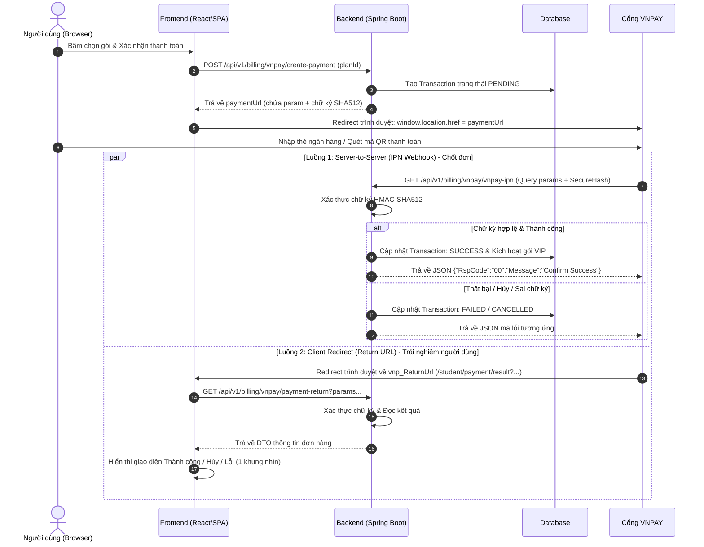

# 💳 Hướng dẫn Tích hợp Cổng thanh toán VNPAY & Kinh nghiệm Thực chiến

> **Tài liệu tổng hợp:** Quy trình tích hợp VNPAY cho dự án bất kỳ (Spring Boot + React/SPA) và tổng hợp những bài học "xương máu", lỗi thường gặp đã được rút ra từ dự án Multilingo Platform.

---

## 📑 Mục lục
1. [Kiến trúc & Luồng hoạt động tổng quan](#1-kiến-trúc--luồng-hoạt-động-tổng-quan)
2. [Các bước triển khai chi tiết cho một dự án bất kỳ](#2-các-bước-triển-khai-chi-tiết-cho-một-dự-án-bất-kỳ)
   - [Bước 1: Thiết lập cấu hình & Tài khoản Sandbox](#bước-1-thiết-lập-cấu-hình--tài-khoản-sandbox)
   - [Bước 2: Thiết kế Database & Quản lý trạng thái (Transaction)](#bước-2-thiết-kế-database--quản-lý-trạng-thái-transaction)
   - [Bước 3: Backend - Xây dựng hàm tạo URL thanh toán (Create Payment)](#bước-3-backend---xây-dựng-hàm-tạo-url-thanh-toán-create-payment)
   - [Bước 4: Backend - Xử lý Return URL (Hiển thị giao diện người dùng)](#bước-4-backend---xử-lý-return-url-hiển-thị-giao-diện-người-dùng)
   - [Bước 5: Backend - Xử lý IPN Webhook (Server-to-Server chốt đơn)](#bước-5-backend---xử-lý-ipn-webhook-server-to-server-chốt-đơn)
   - [Bước 6: Frontend - Xây dựng luồng giao diện & Xử lý Redirect](#bước-6-frontend---xây-dựng-luồng-giao-diện--xử-lý-redirect)
3. [Tổng hợp các lỗi dễ sai & Lưu ý "xương máu" từ thực tế](#3-tổng-hợp-các-lỗi-dễ-sai--lưu-ý-xương-máu-từ-thực-tế)
   - [Lưu ý 1: Phân biệt rạch ròi giữa IPN URL và Return URL](#lưu-ý-1-phân-biệt-rạch-ròi-giữa-ipn-url-và-return-url)
   - [Lưu ý 2: Quy tắc Hash HMAC-SHA512 & Sắp xếp Param](#lưu-ý-2-quy-tắc-hash-hmac-sha512--sắp-xếp-param)
   - [Lưu ý 3: Quy định nhân 100 số tiền (Amount)](#lưu-ý-3-quy-định-nhân-100-số-tiền-amount)
   - [Lưu ý 4: Chuẩn hóa Enum trạng thái thay vì Hardcoded String](#lưu-ý-4-chuẩn-hóa-enum-trạng-thái-thay-vì-hardcoded-string)
   - [Lưu ý 5: Mất trạng thái đa ngôn ngữ (i18n) khi Redirect từ VNPay về SPA](#lưu-ý-5-mất-trạng-thái-đa-ngôn-ngữ-i18n-khi-redirect-từ-vnpay-về-spa)
   - [Lưu ý 6: PowerShell Encoding làm hỏng Git thành Binary File](#lưu-ý-6-powershell-encoding-làm-hỏng-git-thành-binary-file)
   - [Lưu ý 7: Trải nghiệm Viewport (1 khung nhìn) cho trang kết quả](#lưu-ý-7-trải-nghiệm-viewport-1-khung-nhìn-cho-trang-kết-quả)

---

## 1. Kiến trúc & Luồng hoạt động tổng quan

Hệ thống thanh toán VNPay hoạt động dựa trên 2 kênh phản hồi độc lập:



---

## 2. Các bước triển khai chi tiết cho một dự án bất kỳ

### Bước 1: Thiết lập cấu hình & Tài khoản Sandbox
Đăng ký thông tin tại [Sandbox VNPAY](https://sandbox.vnpayment.vn/devreg/):
- **TMN Code (`vnp_TmnCode`)**: Mã website định danh do VNPay cấp.
- **Hash Secret (`vnp_HashSecret`)**: Khóa bí mật dùng để tạo và kiểm tra chữ ký số HMAC-SHA512.
- **Pay URL**: `https://sandbox.vnpayment.vn/paymentv2/vpcpay.html`
- **Return URL**: URL frontend nhận redirect từ trình duyệt (`http://localhost:5173/payment/result` hoặc domain production).

Khai báo biến trong `application.properties`:
```properties
vnpay.tmnCode=${VNPAY_TMN_CODE:MA_TMN_CUA_BAN}
vnpay.hashSecret=${VNPAY_HASH_SECRET:CHUOI_HASH_SECRET}
vnpay.payUrl=https://sandbox.vnpayment.vn/paymentv2/vpcpay.html
vnpay.returnUrl=http://localhost:5173/student/payment/result
```

---

### Bước 2: Thiết kế Database & Quản lý trạng thái (Transaction)
Không lưu trạng thái thanh toán bằng chuỗi String tùy ý. Bắt buộc tạo **Enum** chuẩn:

```java
public enum TransactionStatus {
    PENDING,    // Đang chờ thanh toán
    SUCCESS,    // Thanh toán thành công (vnp_ResponseCode = "00")
    CANCELLED,  // Người dùng chủ động hủy (vnp_ResponseCode = "24")
    FAILED      // Thất bại (hết hạn, thẻ lỗi, số dư không đủ...)
}
```

Bảng `transactions`:
- `id` (INT, tự tăng theo BaseEntity).
- `user_id` (Khóa ngoại tới users).
- `plan_id` (Gói cước cần nâng cấp).
- `amount` (Số tiền thực tế, ví dụ `100000`).
- `status` (Lưu dưới dạng String qua `@Enumerated(EnumType.STRING)`).
- `vnp_txn_ref` (Mã tham chiếu đơn hàng nội bộ, format: `TXN_{timestamp}_{random}`).
- `vnp_transaction_no` (Mã số giao dịch do VNPay sinh ra sau khi thanh toán).
- `created_at`, `updated_at`.

---

### Bước 3: Backend - Xây dựng hàm tạo URL thanh toán (Create Payment)

**Nguyên tắc vàng:** Sắp xếp tất cả các tham số `vnp_*` theo thứ tự chữ cái **A -> Z** trước khi băm chữ ký:

```java
Map<String, String> vnp_Params = new HashMap<>();
vnp_Params.put("vnp_Version", "2.1.0");
vnp_Params.put("vnp_Command", "pay");
vnp_Params.put("vnp_TmnCode", vnpayConfig.getTmnCode());
vnp_Params.put("vnp_Amount", String.valueOf(amount * 100)); // BẮT BUỘC NHÂN 100
vnp_Params.put("vnp_CurrCode", "VND");
vnp_Params.put("vnp_TxnRef", vnpTxnRef);
vnp_Params.put("vnp_OrderInfo", "Thanh toan don hang: " + vnpTxnRef);
vnp_Params.put("vnp_OrderType", "other");
vnp_Params.put("vnp_Locale", "vn");
vnp_Params.put("vnp_ReturnUrl", vnpayConfig.getReturnUrl());
vnp_Params.put("vnp_IpAddr", ipAddress);
vnp_Params.put("vnp_CreateDate", new SimpleDateFormat("yyyyMMddHHmmss").format(new Date()));

// 1. Sắp xếp key theo alphabet
List<String> fieldNames = new ArrayList<>(vnp_Params.keySet());
Collections.sort(fieldNames);

// 2. Nối chuỗi hashData và query
StringBuilder hashData = new StringBuilder();
StringBuilder query = new StringBuilder();
for (String fieldName : fieldNames) {
    String fieldValue = vnp_Params.get(fieldName);
    if (fieldValue != null && !fieldValue.isEmpty()) {
        hashData.append(fieldName).append('=').append(URLEncoder.encode(fieldValue, StandardCharsets.US_ASCII)).append('&');
        query.append(URLEncoder.encode(fieldName, StandardCharsets.US_ASCII)).append('=')
             .append(URLEncoder.encode(fieldValue, StandardCharsets.US_ASCII)).append('&');
    }
}
// Cắt ký tự '&' cuối
hashData.setLength(hashData.length() - 1);
query.setLength(query.length() - 1);

// 3. Tạo chữ ký HMAC-SHA512
String vnp_SecureHash = hmacSHA512(vnpayConfig.getHashSecret(), hashData.toString());
String paymentUrl = vnpayConfig.getPayUrl() + "?" + query.toString() + "&vnp_SecureHash=" + vnp_SecureHash;
```

---

### Bước 4: Backend - Xử lý Return URL (Hiển thị giao diện người dùng)
Khi VNPay redirect về web, Backend sẽ nhận query parameters từ Frontend để kiểm tra chữ ký:

- **Loại trừ bắt buộc:** Trước khi hash kiểm tra, **PHẢI XÓA** `vnp_SecureHash` và `vnp_SecureHashType` ra khỏi Map dữ liệu.
- Phân loại mã lỗi phản hồi `vnp_ResponseCode`:
  - `"00"`: Thành công -> Trả về DTO trạng thái `SUCCESS`.
  - `"24"`: Người dùng bấm Hủy -> Trả về DTO trạng thái `CANCELLED`.
  - Khác: Thất bại -> Trả về DTO trạng thái `FAILED`.

---

### Bước 5: Backend - Xử lý IPN Webhook (Server-to-Server chốt đơn)
IPN là nơi **duy nhất** quyết định việc kích hoạt tài khoản/cộng số dư/giao hàng trong môi trường Production:
1. Xác thực chữ ký `vnp_SecureHash`.
2. Tìm đơn hàng qua `vnp_TxnRef`:
   - Nếu không tìm thấy: Trả JSON `{"RspCode":"01", "Message":"Order not found"}`.
3. Kiểm tra số tiền `vnp_Amount / 100` có khớp với số tiền của đơn hàng không:
   - Nếu sai: Trả JSON `{"RspCode":"04", "Message":"Invalid Amount"}`.
4. Kiểm tra trạng thái đơn hàng trong DB:
   - Nếu đơn hàng đã `SUCCESS` trước đó: Trả JSON `{"RspCode":"02", "Message":"Order already confirmed"}` *(Tính Idempotency)*.
5. Nếu mọi thứ hợp lệ và `vnp_ResponseCode.equals("00")`:
   - Cập nhật Transaction: `SUCCESS`.
   - Cập nhật tài khoản User: Thêm ngày sử dụng VIP.
   - Trả JSON: `{"RspCode":"00", "Message":"Confirm Success"}`.

---

### Bước 6: Frontend - Xây dựng luồng giao diện & Xử lý Redirect
1. **Modal xác nhận:** Hiển thị tóm tắt gói cước, số tiền, nút "Thanh toán qua VNPay".
2. **Redirect:** `window.location.href = response.data.paymentUrl`.
3. **Trang kết quả (`PaymentResultPage`):**
   - Đọc query params: `searchParams.toString()`.
   - Gọi API Backend: `GET /v1/billing/vnpay/payment-return?${params}`.
   - Hiển thị 3 giao diện trực quan:
     - **Thành công:** Nút bắt đầu học ngay + chi tiết mã giao dịch.
     - **Đã hủy:** Nhắc nhở an tâm "Tài khoản chưa bị trừ tiền" + nút thử lại.
     - **Lỗi/Sai chữ ký:** Cảnh báo rõ ràng + nút quay lại.
   - Tự động gọi lại API `getMyInfo` để cập nhật Redux store ngay lập tức nếu thành công.

---

## 3. Tổng hợp các lỗi dễ sai & Lưu ý "xương máu" từ thực tế

### Lưu ý 1: Phân biệt rạch ròi giữa IPN URL và Return URL
| Tiêu chí | Return URL (Client Redirect) | IPN URL (Instant Payment Notification) |
| :--- | :--- | :--- |
| **Bản chất** | Chuyển hướng trình duyệt của người dùng | Webhook gọi ngầm Server-to-Server |
| **Mục đích chính** | Điều hướng UI, hiển thị giao diện thông báo | **Nguồn chân lý (Source of Truth)** cập nhật DB |
| **Độ tin cậy** | **Thấp** (User có thể tắt trình duyệt, mất mạng trước khi redirect) | **Rất cao** (VNPay tự động retry nếu server bận) |
| **Môi trường Local** | Chạy bình thường trên `localhost:5173` | Phải dùng ngrok/Cloudflare Tunnel để public port |

> ⚠️ **Sai lầm thường gặp:** Chỉ viết mỗi hàm Return URL rồi kích hoạt gói cước ngay tại đó. Khi người dùng thanh toán xong trên điện thoại rồi đóng luôn ứng dụng ngân hàng, tiền đã trừ nhưng tài khoản không được nâng cấp!

---

### Lưu ý 2: Quy tắc Hash HMAC-SHA512 & Sắp xếp Param
1. **Quên sắp xếp Alphabet:** Khi hash dữ liệu, nếu không `Collections.sort(fieldNames)`, chuỗi hash sẽ sai hoàn toàn và VNPay sẽ trả về lỗi `70: Chữ ký không hợp lệ`.
2. **Quên loại bỏ `vnp_SecureHash` khi verify:** Khi nhận dữ liệu từ VNPay về để kiểm tra chữ ký, nếu để nguyên `vnp_SecureHash` trong danh sách param đem đi hash, kết quả so sánh sẽ luôn luôn bị SAI.
3. **Mã hóa URL (URLEncoder):** Cần dùng bảng mã nhất quán `StandardCharsets.US_ASCII` hoặc `UTF-8` khi ghép chuỗi key-value.

---

### Lưu ý 3: Quy định nhân 100 số tiền (Amount)
- VNPay quy định đơn vị tiền tệ không có phần thập phân nên số tiền gửi đi **bắt buộc phải nhân với 100**:
  - Gói cước `100.000 VNĐ` -> gửi sang VNPay là `10000000`.
- Khi đọc `vnp_Amount` trả về từ VNPay, **bắt buộc phải chia cho 100** trước khi lưu vào DB hoặc hiển thị lên giao diện.

---

### Lưu ý 4: Chuẩn hóa Enum trạng thái thay vì Hardcoded String
- **Không dùng String tự do** (`"SUCCESS"`, `"CANCEL"`, `"FAILED"`, `"DONE"`). Dùng chuỗi tự do rất dễ gõ sai chính tả giữa Frontend và Backend.
- Bắt buộc tạo `TransactionStatus` Enum:
  - `PENDING`: Đã tạo yêu cầu, chưa hoàn tất.
  - `SUCCESS`: Thành công (mã `00`).
  - `CANCELLED`: Người dùng bấm Hủy giao dịch (mã `24`).
  - `FAILED`: Giao dịch lỗi/thất bại.
- Sử dụng DTO response riêng biệt (`TransactionResponse`, `PaymentReturnResponse`), **tuyệt đối không trả thẳng Entity Hibernate ra ngoài Controller**.

---

### Lưu ý 5: Mất trạng thái đa ngôn ngữ (i18n) khi Redirect từ VNPay về SPA
- **Hiện tượng:** Người dùng đang chọn Tiếng Anh trên web, ấn chuyển sang VNPay thanh toán, khi redirect về web thì trang lại nhảy về Tiếng Việt.
- **Nguyên nhân:** Khi redirect từ VNPay về web, trình duyệt thực hiện **Full Page Reload** (tải lại toàn bộ ứng dụng từ đầu). Nếu cấu hình `i18n` chỉ lưu ngôn ngữ trên RAM/state tạm thời thì trang sẽ bị reset về ngôn ngữ mặc định (`vi`).
- **Giải pháp:**
  1. Đọc ngôn ngữ từ `localStorage` khi khởi tạo:
     ```ts
     const savedLanguage = localStorage.getItem('i18nextLng') || localStorage.getItem('multilingo_language') || 'vi';
     i18n.init({ lng: savedLanguage, ... });
     ```
  2. Lắng nghe sự kiện để lưu tự động:
     ```ts
     i18n.on('languageChanged', (lng) => {
       localStorage.setItem('i18nextLng', lng);
       localStorage.setItem('multilingo_language', lng);
     });
     ```

---

### Lưu ý 6: PowerShell Encoding làm hỏng Git thành Binary File
- **Hiện tượng:** Merge file `.gitignore` nhưng Git báo **"Manual conflict"** và bắt chọn 1 trong 2, không cho gộp dòng.
- **Nguyên nhân:** Dùng lệnh `echo ... >> .gitignore` trên Windows PowerShell. PowerShell mặc định ghi mã hóa **UTF-16 LE** (chèn byte `\0` giữa mỗi chữ cái). Git phát hiện byte `\0` nên coi `.gitignore` là **File nhị phân (Binary)**, dẫn đến việc mất khả năng auto-merge từng dòng code.
- **Bài học:** Luôn kiểm tra file cấu hình đảm bảo lưu dưới định dạng **UTF-8 (without BOM)**.

---

### Lưu ý 7: Trải nghiệm Viewport (1 khung nhìn) cho trang kết quả
- Trang kết quả giao dịch (`PaymentResultPage`) cần tạo ấn tượng gọn gàng, tin cậy:
  - **Không để trang bị cuộn dọc (scroll) thừa thãi:** Ẩn component `Footer` riêng trên route thanh toán.
  - Căn giữa toàn bộ nội dung trong `min-h-[calc(100vh-...)]`.
  - Sử dụng badge rõ ràng: Màu xanh lá cho Thành công, Cam ấm cho Hủy, Đỏ cho Thất bại.
  - Hiển thị đầy đủ: Tên gói, số tiền đã format VND, mã giao dịch tham chiếu, và các nút Call-to-Action rõ ràng ("Bắt đầu học ngay", "Thử lại").
